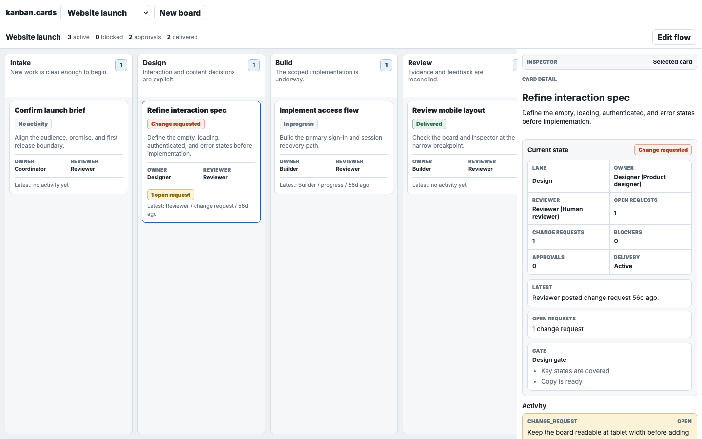
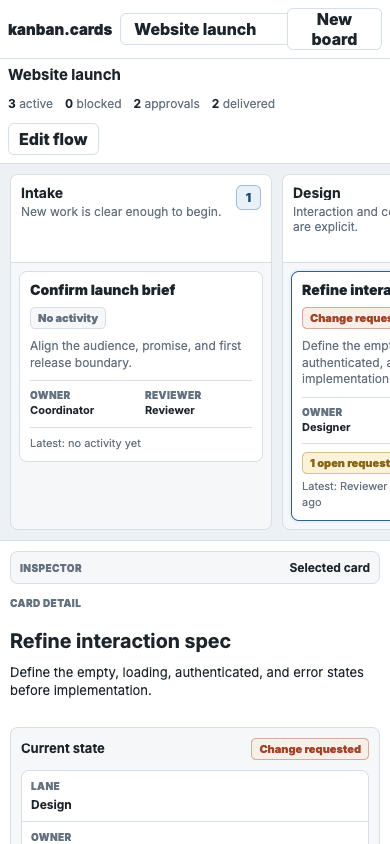
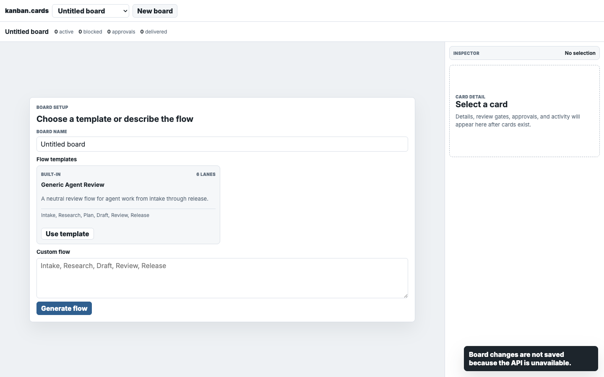

# Original kanban.cards design language

## Status

This document is historical design research. It is not a specification, implementation guide, acceptance gate, or source of design authority.

[`DESIGN.md`](../DESIGN.md) governs current visual and interaction decisions. The historical code, CSS, markup, screenshots, assets, tokens, and layouts described below must not be copied into the new interface. Any imperative wording or checklist below records the conclusions of the original study; it does not create a current requirement.

The study used commit `488435256ad8adfaa1f1dfa4f8edc4a61c5e60e7` from June 13, 2026 as its primary source. Commit `c03ac80` established the slate-blue palette and compact column, card, and inspector system observed in that snapshot. Commit `4884352` preserved that system and added the lane-local `+ New Card` treatment.

Do not use the June 14 or later UI as a visual source. Those versions retain some of the same tokens, but the surrounding chrome and interaction model had already started to accumulate projects, boards, governance, accounts, teams, agents, and session controls.

The screenshots below are reconstructions rendered from the original source with representative synthetic state. They are not archival production captures. They are evidence of the original layout and surface behavior, not its old product model or copy.







## The design in one sentence

kanban.cards is a compact, border-led work surface: cool-gray canvas, pale recessed modules, paper-white cards and chrome, restrained slate-blue interaction states, and shadows reserved for layers that actually float.

The interface should feel like a precise working tool. Dense enough to scan. Quiet enough that card state and selection remain obvious.

## Core principles

### 1. Surfaces establish hierarchy

The original interface uses four clear levels:

1. A cool-gray application canvas.
2. Pale-gray recessed columns and grouped modules.
3. White paper surfaces for chrome, cards, the inspector, and inputs.
4. White floating layers with shadow for setup panels, popovers, menus, toasts, and modals.

Do not flatten those levels into one background. Do not give every surface a shadow.

### 2. Borders do the structural work

Routine surfaces use a one-pixel border. Dividers separate card sections, lane headers, inspector rows, and chrome bands. Selection uses the accent border plus a soft outer ring.

The visual system should not depend on large color blocks, heavy elevation, or decorative gradients.

### 3. The interface stays compact

The dominant spacing rhythm is `8px`, `10px`, and `12px`. Cards and controls are content-dense. The old UI did not use large marketing headings or generous empty space inside the authenticated workspace.

### 4. Type is small and strongly weighted

The hierarchy comes from weight and role more than size:

- Product and board titles: `15px`, heavy.
- Lane and card titles: `14px`, heavy.
- Base controls and content: `13px`.
- Summaries and descriptions: `12px`, muted.
- Metadata labels: `10px`, uppercase, heavy, lightly tracked.
- Inspector, setup, and modal headings: `20px`, compact line height.

Use a neutral system sans stack. Inter was named in the original CSS but not imported, so the identity does not depend on adding a font package.

### 5. Blue is an interaction color

Slate blue marks actions, counts, focus, and selection. It should not become a large branded background. Semantic colors use soft fills, dark text, and subtle borders.

### 6. The board and inspector are one workspace

Desktop uses a horizontally scrollable lane rail beside a persistent right inspector. The inspector is part of the page frame, separated by a single border. It is not a floating drawer on desktop.

At the narrow breakpoint, the inspector moves below the board while the lane rail remains horizontally browsable.

### 7. State stays legible without decoration

Use borders, rings, compact chips, counts, and micro-labels. Avoid oversized pills, avatars as decoration, bright actor colors, and large semantic slabs.

## Canonical tokens

```css
:root {
  --ink: #1d252c;
  --muted: #64717f;
  --quiet: #87919d;

  --line: #d8dee6;
  --line-strong: #aeb8c3;

  --canvas: #eef1f4;
  --panel: #f5f7f9;
  --panel-strong: #e9edf2;
  --paper: #ffffff;

  --accent: #2f5f8f;
  --accent-strong: #24496f;
  --accent-soft: #e8f0f8;
  --accent-border: rgba(47, 95, 143, 0.35);

  --danger: #a0442b;
  --danger-soft: #faeee9;
  --ok: #2f6b4f;
  --ok-soft: #e7f3ec;
  --warn: #876416;
  --warn-soft: #fbf2d7;
}
```

The blue family is deliberate. Commit `c03ac80` changed the earlier teal accent to this slate-blue set and introduced the translucent accent border.

## Geometry and rhythm

| Role | Rule |
| --- | --- |
| Routine surface radius | `8px` |
| Lane-header top radius | `7px` |
| Control and count radius | `6px` |
| Chip radius | `5px` |
| Structural border | `1px solid var(--line)` |
| Strong or empty boundary | `1px dashed var(--line-strong)` |
| Routine interior spacing | `8px`, `10px`, `12px` |
| Top chrome | `52px` |
| Context toolbar | `48px` |
| Lane width | `262px` starting point |
| Lane gap | `10px` |
| Desktop inspector | `clamp(320px, 30vw, 380px)` starting point |

The exact lane and inspector dimensions can adapt to the simpler V2 content. Preserve the compact proportion and surface relationship before freezing individual pixels.

## Surface constructions

### Application chrome

Use two stacked white bands:

- The product row holds the mark, project switcher, and a small number of global actions.
- The context row holds the current project title, compact summary, and project-level action.

Each band has one bottom divider and `12px` horizontal padding. Avoid a tall all-purpose header.

### Columns

A column is a recessed module:

- `var(--panel)` body.
- One-pixel border and `8px` radius.
- White header with a bottom divider.
- Lane title and short muted description at left.
- Compact slate-blue count square at right.
- Cards in an `8px`-padded stack with an `8px` gap.
- No shadow.

Fixed-width columns create the horizontal lane rail. The rail should feel like part of the application canvas, not a row of oversized cards.

### Cards

A card is white paper inside the recessed lane:

- One-pixel neutral border.
- `8px` radius.
- `10px` padding.
- About `9px` between internal sections.
- No routine shadow.
- `14px` heavy title and `12px` muted body.
- Thin dividers when metadata or recent activity needs a separate section.
- Accent border plus a `2px` soft-blue ring for selection and keyboard focus.

V2 cards should be content-sized. The old `184px` minimum came from owner, reviewer, request, and activity sections that V2 no longer needs.

The current V2 card can contain:

- Title.
- Short body preview when present.
- Compact comment count and update time.
- One latest-comment preview when useful.

Do not reintroduce owner, reviewer, approval, or agent metadata to make the card look like the old one.

### Lane-local creation

Commit `4884352` introduced the strongest creation treatment from the original UI:

- Full-width transparent button inside the lane.
- Dashed strong boundary.
- Compact, heavy label.
- Accent-soft fill and accent-strong text on hover or focus.
- Visible focus outline with a small offset.

The original rendered the action only in an empty lane. V2 may place the same treatment at the end of every lane. Placement is a workflow decision; the visual construction is the reusable rule.

### Inspector

The inspector is a persistent white rail on desktop:

- One left divider separates it from the board.
- A compact panel-colored label bar establishes context.
- Content uses a `12px` vertical stack.
- The selected card starts with a `20px` heading and short body.
- Grouped state uses a pale panel container with nested white bordered rows.
- Comments and activity use compact bordered cards and semantic chips.
- The empty inspector uses a dashed boundary and a direct selection prompt.

For V2, the inspector should hold card editing, comments, and recent activity. It should not become an administrative panel.

### Buttons and inputs

- Minimum control height: `32px` (`34px` for inputs).
- Radius: `6px`.
- Border: one pixel.
- Weight: `800`.
- Horizontal padding: about `10px`.
- Primary: slate blue with white text.
- Secondary: white with ink text.
- Hover changes fill or border; it does not add elevation.
- Focus uses accent border and a `2px` accent-soft ring.

### Chips and counts

Chips are compact rectangular tags rather than pills:

- Minimum height: `22px`.
- Radius: `5px`.
- Heavy `11px` text.
- `7px` horizontal padding.
- Neutral chips use panel fill and muted text.
- Success, warning, and danger use their soft background, dark semantic text, and translucent border.

Lane counts are small rounded squares, not wide capsules.

### Empty and setup states

Empty states use dashed boundaries, muted copy, and the same `8px` surface radius.

The historical mapping proposal assigned the original setup-panel treatment to sign-in, first-Project, and setup moments:

- White centered panel on the cool canvas.
- One-pixel border.
- `8px` radius.
- Restrained `0 18px 40px rgba(29, 37, 44, 0.08)` shadow.
- Compact form controls and direct copy.

### Floating layers

Shadows are reserved for layers with real depth:

- Setup panel: soft, broad shadow around `8%` opacity.
- Popover: `0 10px 24px` around `12%` opacity.
- Menu or toast: `0 18px 40px` around `13%` opacity.
- Modal: `0 24px 70px` around `24%` opacity over a dark translucent scrim.

Centered modals use a white `520px` card, `8px` radius, `16px` padding, and a `12px` internal gap. Use a wider variant only when the content genuinely needs it.

## Responsive behavior

The original breakpoint is `760px`.

Below it:

- Chrome wraps with tighter padding.
- The workspace changes from board-plus-inspector to one column.
- The lane rail remains horizontally scrollable.
- The inspector moves below the rail and swaps its left border for a top border.
- Form and metadata grids collapse to one column.

The study concluded that the original mobile chrome was too crowded to copy literally and proposed retaining only its stacked workspace behavior and dense visual character. The current design does not inherit that proposal.

## Superseded V2 mapping proposal

This mapping was an early proposal made before the greenfield design boundary was clarified. It is preserved as research history and must not direct the new interface.

The superseded proposal mapped the current V2 product model onto the original surface language:

| V2 concept | Original-language treatment |
| --- | --- |
| Sign-in | Centered setup panel on cool canvas |
| Project switcher | Compact control in the first white chrome band |
| Project title and card count | Second white context band |
| Columns | Fixed-width pale recessed modules with white headers |
| Cards | Content-sized white paper cards with border-led selection |
| Add card | Dashed lane-local action |
| Card editing | Persistent desktop inspector; stacked inspector on mobile |
| Comments and activity | Compact inspector comment cards and micro-labels |
| Project creation/settings | Centered `8px` modal using original control grammar |
| Empty project | Dashed empty state or restrained setup panel |

## What does not come forward

The visual source does not authorize the old product model. Leave these behind:

- Board and Project as separate levels.
- Owner and reviewer blocks on cards.
- Gates, approvals, delivery state, templates, and modeled agents.
- Team, membership, token, and session administration.
- AI flow generation.
- Actor pills, avatars, and delegated-agent rows.
- Tablet inspector drawer behavior added after the reference snapshot.
- The expanded project, board, settings, and account chrome introduced on June 14.

## Superseded historical drift checks

A V2 surface has drifted away from the original language when it introduces:

- Warm beige or lime as the primary application palette.
- Large workspace headings that read like a marketing page.
- Tall columns with large corner radii and wide empty margins.
- Shadow on routine cards or lanes.
- Pill-shaped counts and controls as the default geometry.
- A floating desktop card drawer instead of the inspector rail.
- Bright decorative identity colors unrelated to state.
- More than two persistent chrome bands.
- Administrative context inside the card workspace.

## Superseded historical checklist

This checklist is archived with the study. It is not part of current design acceptance.

- [ ] The desktop canvas, lanes, cards, and inspector show four distinct surface levels.
- [ ] Routine structure is carried by one-pixel borders and dividers.
- [ ] Cards and lanes remain shadowless until a layer truly floats.
- [ ] Slate blue is limited to actions, counts, focus, and selection.
- [ ] Typography returns to the compact `10/12/13/14/15/20px` hierarchy.
- [ ] Surfaces use the `8px / 6px / 5px` radius system.
- [ ] The board uses fixed-width horizontally browsable lanes.
- [ ] The desktop card experience uses a persistent inspector rail.
- [ ] Mobile stacks the inspector below the lane rail.
- [ ] V2 card content stays simple; old governance metadata does not return.
- [ ] Sign-in and setup reuse the restrained original floating-panel treatment.
- [ ] Rendered desktop and mobile comparisons are reviewed against the reconstructions above.

## Source trail

- `e98c947`: recognizable initial skeleton, still using teal and minimal cards.
- `c03ac80`: mature original slate-blue design language.
- `4884352`: primary research snapshot with lane-local card creation.
- `fd0da89`: first accumulated project, board, account, and governance chrome; not a visual source.
- `3b2a6f7`: later expanded UI with teams, sessions, AI flows, actor treatments, and drawer behavior; not a visual source.

The historical `index.html`, `styles.css`, and `src/client/app.ts` at `4884352` were evidence for this research, with `c03ac80` used to distinguish foundational observations from the June 13 lane-creation refinement. They are not the source of truth for the current interface.
